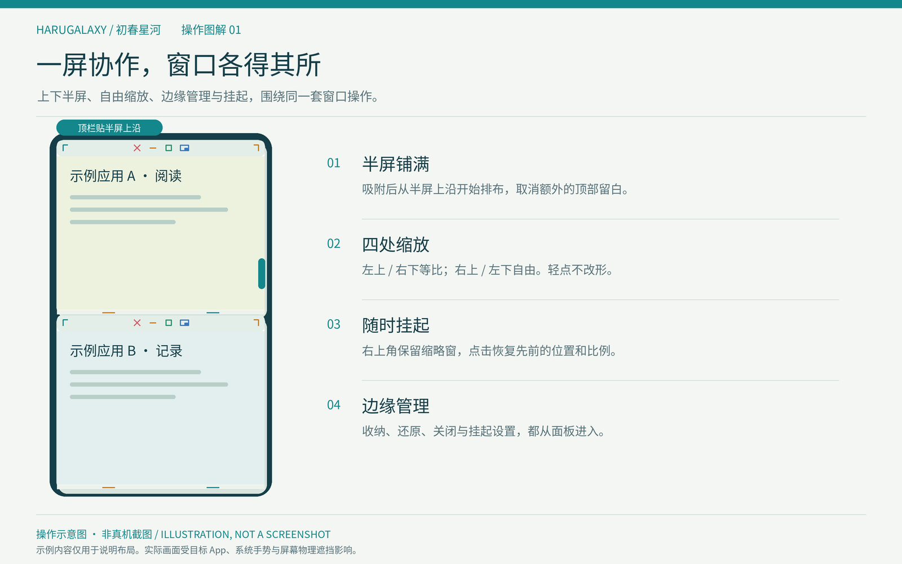
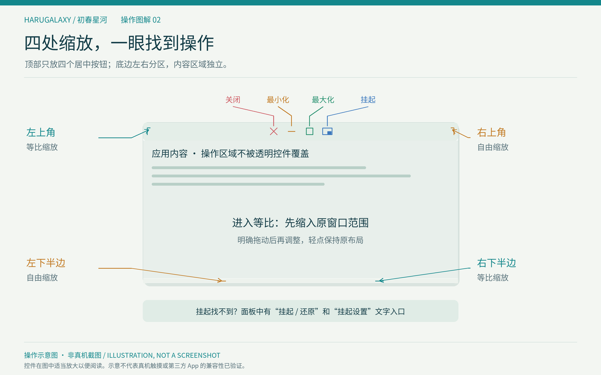
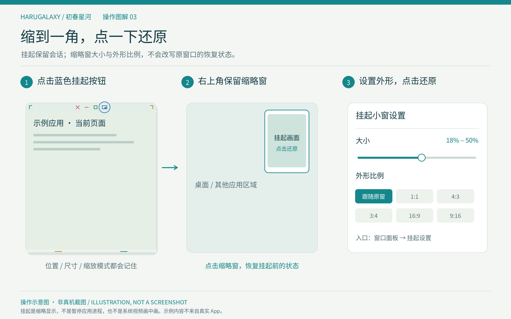
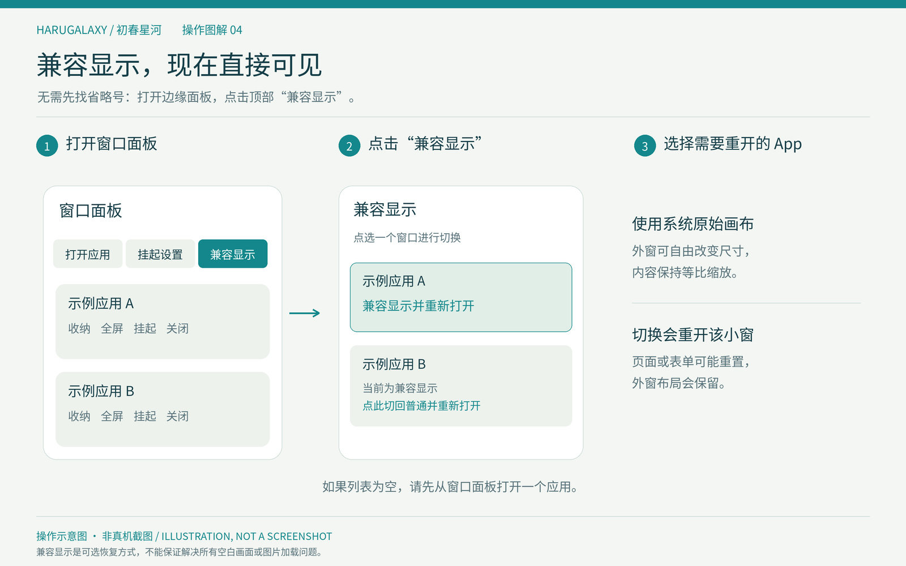

# HaruGalaxy · 初春星河

[简体中文](README.md) · [Download 0.3.17](https://github.com/Airs-Kotex/HaruGalaxy/releases/tag/v0.3.17) · [Issues](https://github.com/Airs-Kotex/HaruGalaxy/issues)

A native multi-window workspace for TrollStore. HaruGalaxy hosts installed apps in movable windows with an edge panel, free or original-aspect resizing, half-screen snapping and local diagnostic exports.

The edge entry, title bars and window panel now use translucent glass controls, with dark/light appearance, Reduce Transparency and contrast adaptations.

The 0.3.17 assets are **build23**, fixing stale canvas proportions after repeated free/proportional resize switches. Dragging keeps a scaled preview; successful release adopts the final content viewport in free mode or the system canvas in proportional mode. Install over 0.3.16; Settings should show **0.3.17 (23)**. Actual gestures, layout and touch still require device validation; see the [implementation and limitations](docs/implementation-status-0.3.17.md).

## Illustrated guides

These are **operation illustrations, not simulator or physical-device screenshots**. App content is abstract sample content; the images do not demonstrate device compatibility.





## Install

1. Install [TrollStore](https://github.com/opa334/TrollStore) on a supported device.
2. Download [HaruGalaxy-0.3.17.tipa](https://github.com/Airs-Kotex/HaruGalaxy/releases/download/v0.3.17/HaruGalaxy-0.3.17.tipa).
3. Open the file in TrollStore and install it over an existing 0.3.1 or later installation.
4. Open HaruGalaxy and enable the floating workspace in Settings.

Bundle identifier: `io.github.airskotex.harugalaxy`. Versions0.3.0 and earlier use a different identifier; preferences and logs do not migrate automatically. Versions0.3.2 and0.3.11 were withdrawn. Other releases remain available in [Releases](https://github.com/Airs-Kotex/HaruGalaxy/releases).

## Controls

| Gesture | Behavior |
| --- | --- |
| Tap the edge tab | Toggle the window panel |
| Hold still and release | Toggle the panel |
| Drag the entry directly | Move freely and keep the release position |
| Release near either side | Dock and retract to a small tab while idle |
| Settings → “入口保持展开” | Keep the entry expanded |
| Tap outside the panel | Close it without activating the app underneath |
| Drag a title bar | Move the window |
| Top-right or bottom-left half | Resize width and height freely |
| Top-left or bottom-right half | Resize using the system's original logical aspect ratio |
| Drag a free window near an edge, dwell, release | Snap to top/bottom in portrait or left/right in landscape |
| Minimize | Store the window in the edge panel |
| Maximize / double-tap the title | Fill the screen; restore through the edge panel |
| Fourth blue top button / panel “挂起” | Park a live thumbnail at the top right |
| Panel “挂起设置” | Jump to thumbnail size and aspect settings |
| Panel “原始画布” | Open a visible list of windows and select one to change display mode |
| Tap a parked thumbnail | Restore prior position, dimensions, resize and snap/full-screen state |
| App row → … → open original app | End that hosted window and open the ordinary app |

Each app has one window, with up to four sessions at a time. Entry position is saved across launches and adapted on rotation. An undocked entry stays expanded. Drag it away from frequently used app controls; the previous inward-pull opening gesture now moves the entry, while a tap opens its panel.

The top bar is28 points high and the bottom edge8 points. Four centered top controls are Close, Minimize, Maximize and Park; the app title is removed. Top-left/bottom-right control aspect resizing, while top-right/bottom-left resize freely. The bottom edge is split into two halves, each marked by a small line. Controls stay outside guest content.

All four resize handles require14 points of movement. Entering aspect mode first fits inside the previous window footprint, so a wide half-screen window does not expand to full height. Top-left and bottom-right allow shrinking from opposite directions. A tap leaves the window unchanged.

All four handles preserve the running app's canvas during the drag and scale a complete preview. On successful release, ordinary free mode adopts the final content viewport and proportional mode restores the system canvas, including after repeated free/proportional switches. A cancelled or sub-threshold drag keeps the previous layout. In ordinary mode, snapping and maximizing explicitly adopt the target viewport; restoring maximization restores the previous window canvas. Original-canvas mode keeps the device canvas throughout, with margins when aspect ratios differ.

Snapped windows place their header at the top of the complete half-screen rectangle without a separate safe-top spacer. Ordinary-window header protection returns after leaving the snap. Physical cutouts and system gestures still apply.

When guest content reaches a system edge exclusion, the workspace passes the overlapping safe-area insets to the app, converted into its logical coordinates when scaled. Apps must honor these insets in their own layout. The footer remains8 points.

## Parking

Use the fourth blue top button or panel's **“挂起”** text action, then tap the top-right thumbnail to restore. Its icon is drawn by the app rather than relying on an SF Symbols name. **Panel → 挂起设置** jumps directly to size(18%–50%) and aspect settings(original,1:1,4:3,3:4,16:9,9:16). Settings title shows version/build: **0.3.17 (23)**. Multiple thumbnails stack in the safe area; their appearance does not change restored geometry. Parking keeps sessions alive, not process suspension.



## Original canvas

Use **Edge entry → panel top “原始画布” → select an app**. The list offers reopening with the original canvas or returning to ordinary window-sized layout. If empty, open a guest window first. The previous per-app ellipsis menu remains available.

Original-canvas mode reopens with the system's native logical canvas. The outer window can still resize freely; content scales instead of repeatedly changing the app's layout size.

The choice is saved per app. Switching recreates that hosted session and may lose form state, while preserving outer layout, snap/full-screen and parked state. The reported iOS15 issues in870 Game Box andTelegram are not device-confirmed fixed; layer registration does not establish correct images or media loading.



## Search

Tap the search field to filter apps by name or bundle identifier. If the floating scene does not display a keyboard, HaruGalaxy opens its normal app interface for input. You can also tap **“在主应用中搜索”** (“Search in the main app”). Selecting an app or cancelling restores the floating workspace and preserves existing sessions.

If iOS rejects the foreground request, the floating workspace returns with a message. Search text is never written to diagnostic logs.

## Keyboard and switching to the ordinary app

Direct keyboard presentation inside hosted apps remains unresolved. The copy input board was removed; normal-app search is preserved. When the complete hosting APIs are absent, build19 stops active guest focus selection and its input-environment remapping. Hidden keyboard interception remains unconfirmed; original-canvas mode is a layout option and cannot repair keyboard routing or missing scene layers. To diagnose keyboard or bottom-control issues, choose **Settings → “采集键盘诊断（20秒）”**, tap the affected guest control during the next20 seconds, then export the diagnostic bundle.

To switch to the ordinary app, use **… → 结束小窗并打开原应用** on its panel row. Capability checks run before ending the hosted window. When the newer deactivation method is absent, an older scene-settings update path is used; if neither is available, the window stays open. Successful release is followed by an ordinary launch request, with other windows collected into the panel. The target is not automatically recreated, and forms/cursor positions may differ.

On iOS 14–17, the Liquid Glass-inspired appearance uses existing UIKit blur and custom edge layers. It does not provide iOS 26+'s native glass API. Guest content remains clear; Reduce Transparency switches controls to opaque backgrounds.

## Compatibility

The arm64 build targets the officially supported TrollStore range: iOS/iPadOS 14.0 beta 2–16.6.1, 16.7 RC (20H18), and 17.0. User feedback covers background floating use and entry interaction on iPhone 14 Pro Max / iOS 16.2.

External scenes, keyboard routing and dynamic sizes depend on iOS and the hosted app. iOS 14 has upstream scene-hosting limitations; see the [compatibility record](docs/compatibility.md). System gestures and hardware cutouts remain controlled by iOS. Restarting HaruGalaxy does not automatically reopen guest windows or the floating workspace.

## Build

```sh
git clone https://github.com/Airs-Kotex/HaruGalaxy.git
cd HaruGalaxy
make test
make package
make verify
```

Requires Clang, an iPhoneOS SDK, a Mach-O linker and ldid. See [build instructions](docs/build-environment.md) for Linux/WSL setup. Source archives build without Git metadata. SDKs, caches and user logs are excluded.

Packages, checksums and build reports are written to `dist/`. Developer checks and device records live in `Tests/`, `docs/` and release attachments.

## Feedback

Open the window panel → Settings → Diagnostics → mark the issue → export. Include the app version, device, exact iOS build and reproduction steps when reporting an [issue](https://github.com/Airs-Kotex/HaruGalaxy/issues).

Logs stay on the device, rotate at approximately 8 MiB, and are exported only by the user. They record scene, window and input stages without recording the screen or typed text. Inspect and redact application identifiers before sharing publicly.

The timed capture samples at most once per second: input requests, focus ownership, method signatures, window visibility/levels, safe insets and bottom hit queries. Queries do not inject touches; delivered touch logs contain region categories, not coordinates or text. Sampling does not change focus or read keycodes or clipboard contents.

App launch also records selected version/scene declarations and bounded client/layer observations over the first12 seconds. No screenshots, app images or chat contents are read.

```sh
python3 scripts/inspect_diagnostics.py /path/to/HaruGalaxy-Diagnostics-example.json
```

## Credits and license

Maintained by [Airs-Kotex](https://github.com/Airs-Kotex). Thanks to [straight-tamago / UiharuX](https://github.com/straight-tamago/UiharuX), [YuriDevTeam / MilkyWay3](https://github.com/YuriDevTeam/MilkyWay3-Public), [khanhduytran0 / FrontBoardAppLauncher](https://github.com/khanhduytran0/FrontBoardAppLauncher), [Lessica / TrollSpeed](https://github.com/Lessica/TrollSpeed), [LiveContainer](https://github.com/LiveContainer/LiveContainer), [opa334 / TrollStore](https://github.com/opa334/TrollStore), Theos, runtime-header maintainers and LLVM contributors.

The [Chinese README](README.md#借鉴项目与致谢) describes each project's role and reuse boundary. HaruGalaxy is an independent project. New implementation uses Apache-2.0; third-party licenses and notices are retained in [NOTICE.md](NOTICE.md) and `ThirdParty/`.

[Contributing](CONTRIBUTING.md) · [Changelog](CHANGELOG.md) · [Security reporting](SECURITY.md)

## Star history

[](https://star-history.com/#Airs-Kotex/HaruGalaxy&Date)

## Minimized execution, rotation and closing

**Settings → 浮动工作区 → 最小化行为** selects system-managed suspension (default) or background keepalive. The setting applies immediately to minimized windows; their panel rows show whether the OS granted keepalive. System-managed suspension does not forcibly freeze an app, and keepalive can be revoked. Parking remains a live visual thumbnail.

The workspace and guests follow physical orientation, including both landscape directions and iPad upside-down portrait. A flat device retains the last direction. Hidden and parked windows restore using the current geometry. The universal package supports iPhone and iPad; tablet/split-view geometry is covered by portable checks, with actual iPad behavior awaiting device feedback. An app may still decline a native landscape layout.

Explicit Close cleans up the guest scene and asks RunningBoard to terminate the original hosted process instance. Unsaved state and other pages in that same process may be lost. Native seamless handoff cannot currently be guaranteed, so this is the requested process-exit fallback. Exit is observed separately from request acceptance; failures are reported. Minimize, parking and automatic host teardown do not terminate guest processes.

Keyboard layer changes trigger bounded automatic diagnostics while guests are present. The reader defaults to the export session; use `--session all` to include historical launches. No pixels, text, keys or clipboard are collected.

## Entering a new window

Opening a new hosted window first ends the selected app's original process, waits for confirmed exit, and then launches a fresh scene. This prevents the previous native player from sharing the process with a second hosted player. Unsaved state and playback position may be lost. If the OS rejects termination, window creation stops with an error; pending requests can be completed by manually ending the app from the system app switcher. Restoring an existing minimized or parked window does not restart it. Switching canvas modes creates a new window and therefore also resets the app.

Build20 corrects native versus oriented scene dimensions and normalizes UIKit's existing presentation transform on an app-owned parent. Low-rate gravity updates supplement orientation notifications while visible windows exist; hiding/locking the workspace stops them. Device feedback for this build is still needed to confirm landscape touch and media behavior.
