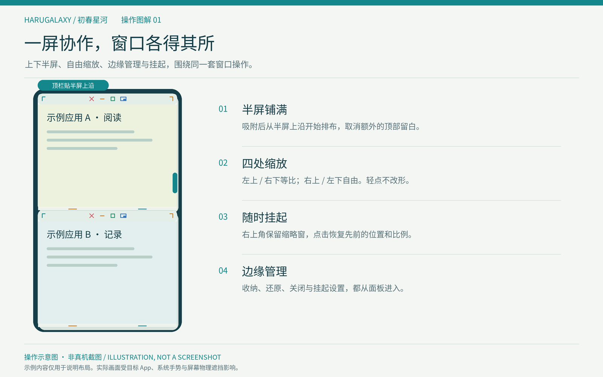
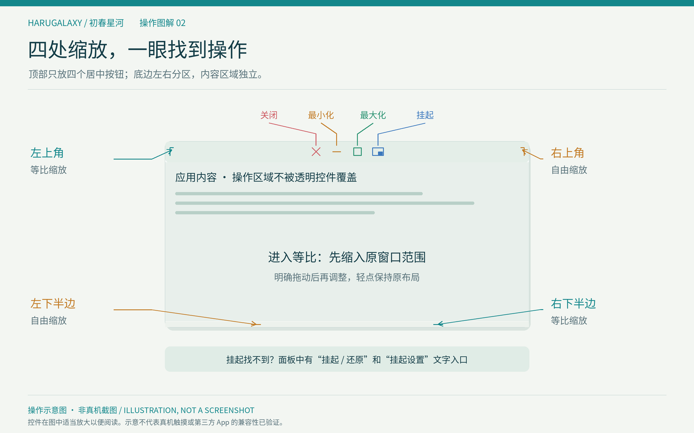
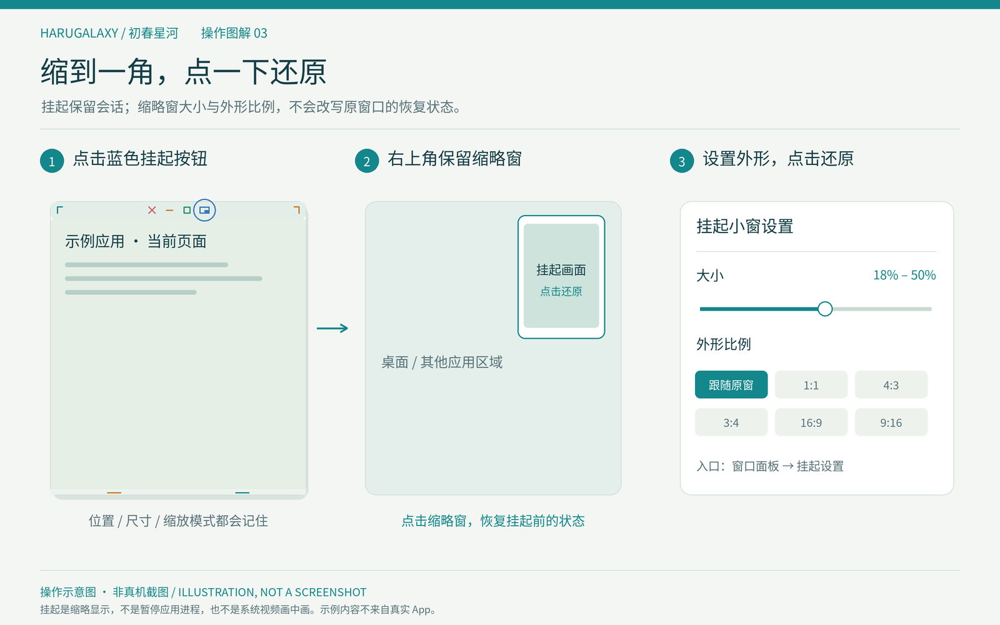
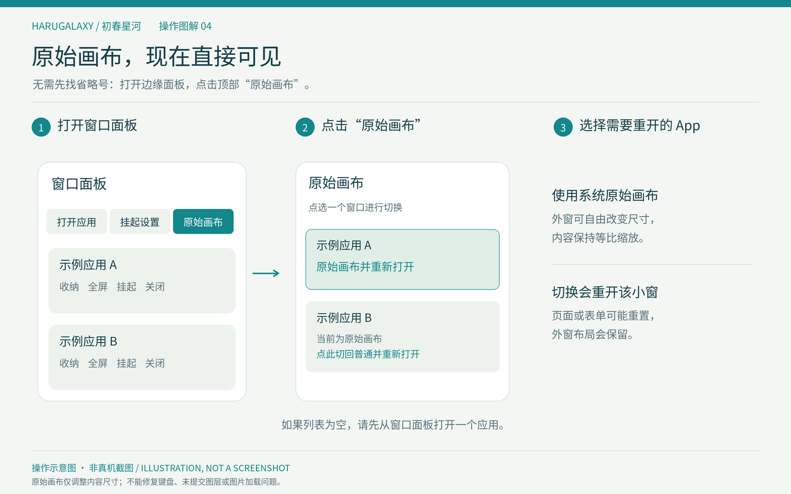

<p align="center">
  
</p>

<h1 align="center">HaruGalaxy · 初春星河</h1>

<p align="center">为 TrollStore 用户打造的原生多窗口工作台</p>

<p align="center">
  <a href="https://github.com/Airs-Kotex/HaruGalaxy/releases"></a>
  <a href="https://github.com/Airs-Kotex/HaruGalaxy/actions/workflows/core-tests.yml"></a>
  <a href="LICENSE"></a>
  <a href="https://github.com/Airs-Kotex/HaruGalaxy/stargazers"></a>
</p>

<p align="center">简体中文 · <a href="README.en.md">English</a> · <a href="https://github.com/Airs-Kotex/HaruGalaxy/releases">下载</a> · <a href="https://github.com/Airs-Kotex/HaruGalaxy/issues">反馈</a></p>

HaruGalaxy 将已安装应用放进可移动、缩放和收纳的小窗，让多个 App 在同一屏幕中协作。以 UiharuX 的多任务能力和 MilkyWay 的操作体验为参考，采用原生 Objective-C / UIKit 实现。

**当前版本：[0.3.13](https://github.com/Airs-Kotex/HaruGalaxy/releases/tag/v0.3.13)** · [更新记录](CHANGELOG.md)

当前附件为 **build 19**，合并最小化运行方式、随设备方向旋转、iPad 布局适配，以及关闭应用的进程退出处理。可从0.3.12覆盖升级；设置页应显示 **0.3.13（19）**。

## 核心亮点与操作图解

下面是按当前功能绘制的**操作示意图，并非模拟器或真机截图**。示例应用内容仅用于说明布局。





## 功能

- **原生应用小窗**：启动已安装 App，直接操作真实内容。
- **后台浮动工作区**：离开主应用后，通过屏幕边缘入口管理窗口。
- **透明玻璃控件**：入口、标题栏和面板采用 Liquid Glass 风格，适配深浅色、降低透明度和高对比度。
- **边缘收纳**：最小化收入面板，恢复、全屏和关闭集中管理。
- **最小化运行方式**：可选系统挂起或后台保活，面板显示保活是否获批。
- **iPhone / iPad 方向跟随**：窗口和内容随设备横竖方向调整，iPad 同时支持倒置竖屏。
- **四处缩放入口**：左下底边与右上自由缩放；右下底边与左上按系统原始比例缩放。
- **半屏与全屏**：拖动并停留即可吸附半屏，也可铺满屏幕。
- **画中画式挂起**：缩到右上角保留画面，点击还原；大小和外形比例可在设置中调整。
- **按应用原始画布**：固定逻辑画布并缩放显示，适合需要保持原始布局的 App。
- **边缘安全区**：应用内容靠近系统手势区域时同步安全区，等比模式按应用坐标换算。
- **自由放置的入口**：轻点打开，按住直接拖动；松手停留，靠近左右边缘才吸附收起。
- **应用搜索**：按名称或 Bundle ID 查找，支持最近使用；键盘未出现时自动转入主应用输入。
- **主题与本机日志**：深浅色、减少动画、位置记忆及手动诊断导出。

目前每个 App 一个窗口，最多同时保留四个会话。

## 安装与升级

1. 设备已安装 [TrollStore](https://github.com/opa334/TrollStore)。
2. 下载 [HaruGalaxy-0.3.13.tipa](https://github.com/Airs-Kotex/HaruGalaxy/releases/download/v0.3.13/HaruGalaxy-0.3.13.tipa)。
3. 从“文件”或分享菜单交给 TrollStore 安装，已有 0.3.1 及后续版本可直接覆盖。
4. 打开 **初春星河**，在设置中启用“浮动工作区”。

Bundle ID：`io.github.airskotex.harugalaxy`。0.3.0 及更早版本使用旧标识，其设置和日志不会自动迁移。历史版本可在 [Releases](https://github.com/Airs-Kotex/HaruGalaxy/releases) 中获取；0.3.2、0.3.11 已撤回。

## 使用教程

### 入口与窗口管理

| 动作 | 结果 |
| --- | --- |
| 轻点边缘凸起 | 打开或关闭窗口面板 |
| 原地长按后松手 | 打开或关闭面板 |
| 按住直接拖动 | 自由移动入口，松手停在当前位置 |
| 拖到左右边缘附近再松手 | 吸附边缘，空闲时收成小凸起 |
| 设置 → 入口保持展开 | 让入口保持较宽的图标 |
| 面板 → 打开应用 | 搜索或选择已安装 App |
| 黄色减号 | 将窗口收入面板，按设置交给系统挂起或申请保活 |
| 设置 → 浮动工作区 → 最小化行为 | 在“系统挂起”和“保活”之间切换，立即应用于已最小化窗口 |
| 点击面板中的窗口条目 | 恢复或聚焦窗口 |
| 顶部居中第四个蓝色按钮 / 面板“挂起” | 缩到右上角，保留挂起前的窗口状态 |
| 面板“挂起设置” | 直接进入挂起大小与外形比例设置 |
| 面板“原始画布” | 列出当前窗口，选择应用切换显示模式并重新打开 |
| 点击右上角挂起小窗 | 还原原位置、尺寸、缩放模式和半屏/全屏状态 |
| 面板条目的 … → 结束小窗并打开原应用 | 结束该小窗并打开原应用，其他小窗收纳 |
| 红色关闭 | 清理小窗并请求结束该应用的原始进程；未保存内容可能丢失 |
| 面板外轻点 | 仅关闭面板，该次点击不操作下层 App |

入口放在屏幕中间时保持展开，贴边时保留小凸起。位置会保存并随横竖屏调整。若挡住 App 常用按钮，可直接拖开；原来的“向内短拉打开”现在属于拖动，打开面板请轻点。

### 最小化、关闭与设备方向

“系统挂起”释放本应用的保活请求，由 iOS/iPadOS 决定后台挂起与内存回收，不强制冻结进程。“保活”对已最小化应用申请后台执行，面板显示“保活已获批”或“保活未获批”；系统仍可能撤销请求。右上角挂起缩略窗继续显示实时内容，与最小化的运行方式分开。

点击红色关闭会先清理场景，再按该小窗创建时取得的进程句柄请求结束应用，避免下一次原生打开复用残留的托管进程。确认退出前会保留“正在结束”的小窗和面板记录。请求超时会显示仍在处理并继续观察；系统拒绝则显示失败，可手动结束后重试。请求被接受不等于退出已确认。关闭会丢失未保存内容，同一进程中的其他应用页面也会结束。主应用自身退出/工作区清理不会自动结束所有第三方应用进程。

设备横放时，工作区与所有小窗切换横屏；平放时保持上次有效方向。最小化或挂起后旋转，恢复时按当前方向重新布局。iPad 支持四个方向及不同可用窗口尺寸；第三方 App 是否采用原生横屏布局仍受其自身实现限制。

### 缩放、半屏与全屏

- **右上角、左下底边**：自由调整宽高，分别固定对角，App按新视口重新排版。
- **左上角、右下底边**：按当前屏幕方向的系统原始画布比例缩放。进入等比时先缩入原窗口范围，不再为了保留宽度把半屏拉成整屏高；之后可以从任一等比入口继续缩小或放大。
- **底边左右分区**：左半是自由缩放，右半是等比缩放，各有一条细线提示。四处入口均需拖动超过14点才开始，轻点不改形。
- **半屏**：先进入自由缩放模式，再拖标题栏让窗口边缘靠近屏幕边缘，短暂停留，看到预览后松手。竖屏为上下半屏，横屏为左右半屏。吸附后的顶栏贴着该半屏上沿，不再额外下移整个顶部安全区高度；退出半屏后恢复普通窗口的顶栏避让。
- **全屏**：点击绿色按钮或双击标题栏；通过边缘面板还原、最小化或关闭。

普通窗口可以拖到屏幕顶部。窗口贴近屏幕底部或横屏侧边时，会把实际进入系统安全区的部分传给应用，帮助其避让底部按钮。目标 App 是否遵循安全区取决于自身布局；动态岛等物理遮挡、状态栏及系统手势仍由 iOS 管理。

顶部不显示应用名称，中央依次为 **关闭、最小化、最大化、挂起**。按钮区域也可以作为拖动起点：轻点执行按钮，按住拖动则移动窗口。应用名称仍可在窗口面板查看。

### 挂起与还原

点击顶部中央第四个蓝色按钮，或面板中的 **挂起** 文字按钮，窗口会缩到右上角；多个挂起窗口沿右侧排列。点击缩略窗或面板“还原”即可还原，不会把缩略窗尺寸保存成正常窗口尺寸。顶部挂起图形由应用自行绘制，不依赖系统是否有对应图标。

通过面板 **挂起设置** 可直接定位设置项，也可进入 **设置 → 挂起小窗**。大小可调为可用区域短边的18%–50%，比例可选跟随原窗口、1:1、4:3、3:4、16:9、9:16。画面保持等比，必要时留边；这些设置不改变还原后的比例。设置标题显示版本与build，当前应为 **0.3.13 (19)**。挂起保留会话，不等于暂停应用进程。



### 画面异常时的原始画布

入口现在直接放在窗口面板顶部：**轻点边缘入口 → 原始画布 → 点选需要调整的 App**。普通模式下会显示“原始画布并重新打开”；已经启用兼容的窗口可从同一列表切回普通模式。如果列表为空，先打开一个小窗。App条目右侧省略号菜单中的旧入口也保留。

App从系统原始画布启动，外窗自由改变大小时内容等比缩放，不再不断改变App内部尺寸。切回普通显示后恢复按窗口尺寸布局。

选择按App保存，切换会释放并重建该小窗，可能丢失当前表单状态；外窗位置、尺寸、半屏/全屏及挂起状态会保留。此选项只调整布局，不修复键盘或应用未提交画面的情况。当前设备反馈确认，改用原始画布未解决部分应用的显示问题；870游戏盒与Telegram在iOS15上的图像问题也仍未确认修复。



上下控件合计占用36点。底部保留左右两条细线和接触高亮，没有额外按钮或文字。

### 搜索应用

点击搜索栏即可按应用名称或标识筛选。如果浮窗没有显示键盘，会自动打开初春星河的主界面继续输入，也可以直接点击 **“在主应用中搜索”**。选中应用或取消后恢复浮窗，已打开的窗口会保留。

切换过程中如系统拒绝打开主应用，会恢复浮窗并显示提示。搜索文字只用于本次筛选，不写入诊断日志。

### 小窗输入与玻璃外观

小窗内直接呼出键盘尚未支持稳定使用，复制输入板已移除。build19 在缺少完整托管接口时停止主动选择多开应用的键盘焦点及关联的输入环境改写，避免反复执行没有呈现路径的请求；不再提供这条不可用的直接输入尝试。这不代表不可见键盘或下方触摸失效已在真机上修复。主应用搜索输入保留。需要反馈键盘或底部点击问题时，在 **设置 → 真机诊断 → 采集键盘诊断（20秒）** 开始采集，点击问题按钮或文本框，然后导出诊断包。

需要切回普通应用时，选择面板内该 App 的 **… → 结束小窗并打开原应用**。先检查接口，再结束目标小窗，等待停用并释放后打开原应用；其他小窗收进面板。缺少新版停用接口时尝试旧版设置更新路径，两条路径都不可用则保留小窗。成功结束的目标小窗不会自动重建，原应用不保证保留表单位置。

玻璃材质用于操作控件，App 内容区保持清晰。iOS 14–17 使用现有 UIKit 材质实现 Liquid Glass 风格；它不是把 iOS 26+ 的系统效果移植到旧系统。开启“降低透明度”后自动改用不透明背景。

## 兼容性

- 面向 TrollStore 官方支持系统：iOS/iPadOS 14.0 beta 2–16.6.1、16.7 RC（20H18）、17.0，构建架构为 arm64。
- 同一安装包支持 iPhone 与 iPad，保留 iPad 四方向声明并适配平板/分屏尺寸。尚无本版 iPad 真机结果。
- 已有 iPhone 14 Pro Max / iOS 16.2 的后台浮窗与入口操作反馈。
- 外部 App 场景、键盘和动态窗口尺寸受系统及目标应用限制；iOS 14 的场景托管存在上游限制，其他设备记录见 [兼容性说明](docs/compatibility.md)。

应用重启后不会自动开启浮动模式或重新打开窗口。明确点击关闭会请求结束对应应用进程；最小化和右上角挂起不结束进程。

## 反馈与日志

在窗口面板进入 **设置 → 真机诊断 → 标记刚发生的问题 → 导出诊断包**，并在 [Issue](https://github.com/Airs-Kotex/HaruGalaxy/issues/new/choose) 中说明版本、机型、系统 build 和复现步骤。

日志保存在本机，滚动存储约 8 MiB，包含场景、窗口、输入阶段与系统状态；不录屏、不记录输入文字、不自动上传。公开分享前请检查并按需隐藏应用标识等个人信息。

限时诊断每秒最多采样一次，记录目标 App 的输入请求、焦点归属、接口签名、窗口显示状态、安全区以及底部命中检查。命中检查是本机视图查询，不会模拟点击；实际接收到的触摸仅记录区域类别，不记录坐标、文字、按键或剪贴板。

键盘图层发生变化时会自动采样，区分已登记、已托管和未托管的图层，并记录实际远程键盘窗口状态。日志读取工具默认仅分析导出时的会话，`--session all` 可查看历史。

显示问题还会自动记录所选App的版本、场景声明，以及打开后前12秒的客户端连接和图层登记状态。这些是状态观察，不截图，也不读取App内的图片或聊天内容；图层存在并不证明画面显示正确。

```sh
python3 scripts/inspect_diagnostics.py /path/to/HaruGalaxy-Diagnostics-example.json
```

## 从源码构建

```sh
git clone https://github.com/Airs-Kotex/HaruGalaxy.git
cd HaruGalaxy
make test
make package
make verify
```

构建需要 Clang、Mach-O linker、iPhoneOS SDK 和 ldid。Linux/WSL 配置、工具来源与摘要见 [构建说明](docs/build-environment.md)。源码包可脱离 Git 构建，仓库不分发 Apple SDK、下载缓存和用户日志。

产物位于 `dist/`：安装包、SHA-256 与构建报告。开发验证和设备记录位于 `Tests/`、`docs/` 及发布附件。

## 工程结构

```text
Sources/Core/          几何、手势、输入转场、启动状态与日志存储
Sources/Platform/      应用枚举、场景托管、主应用激活与后台执行
Sources/UI/            窗口、角标、边缘面板、搜索和设置
Sources/Diagnostics/   本机事件记录与导出
Resources/             清单、权限、图标与名称本地化
ThirdParty/            上游声明、compiler-rt 与许可证
Tests/                 核心逻辑及工具回归检查
scripts/               构建、打包、校验和日志读取
```

## 借鉴项目与致谢

| 项目 / 作者 | 本项目中的作用 | 复用边界 |
| --- | --- | --- |
| [UiharuX](https://github.com/straight-tamago/UiharuX) · [straight-tamago](https://github.com/straight-tamago) | TrollStore 多任务能力与体验参考 | 没有打包原程序或图标；公开仓库不提供完整实现源码 |
| [MilkyWay 3](https://github.com/YuriDevTeam/MilkyWay3-Public) · [YuriDevTeam](https://github.com/YuriDevTeam)、[Soh Satoh](https://twitter.com/soh_satoh) | 窗口移动、缩放、最小化与最大化的交互启发 | 不包含其闭源插件二进制 |
| [FrontBoardAppLauncher](https://github.com/khanhduytran0/FrontBoardAppLauncher) · [khanhduytran0](https://github.com/khanhduytran0) 及贡献者 | 外部 App scene 启动、托管与浮动 binder 的核心参考 | 固定上游接口声明、保留 Apache-2.0 许可；生命周期另行修改 |
| [TrollSpeed](https://github.com/Lessica/TrollSpeed) · [Lessica](https://github.com/Lessica) | TrollStore 全局窗口和生命周期资料 | 架构参考，未拷贝 HUD 实现 |
| [LiveContainer](https://github.com/LiveContainer/LiveContainer) · 项目维护者与贡献者 | 场景/窗口管理参考 | 未拷贝其实现文件；上游头文件原有来源注释保留 |
| [键盘焦点调查](https://gist.github.com/khanhduytran0/504b16d86a2091e676c412bd0a517306) · khanhduytran0、HugeBlack；[iOS 17 Runtime Headers](https://github.com/MTACS/iOS-17-Runtime-Headers) · MTACS | 托管场景可见性和键盘仲裁资料 | 本项目按已登记的 PID 与 scene 环境精确匹配，自行实现范围和生命周期控制 |
| [TrollStore](https://github.com/opa334/TrollStore) · [opa334](https://github.com/opa334) 及贡献者 | 安装和权限机制 | 运行前提，遵循其支持范围 |
| [Theos headers](https://github.com/theos/headers) · Theos 团队 | 私有接口声明与 SDK 工具资料 | 运行时检查所需接口 |
| [Apple Runtime Headers](https://github.com/LeoNatan/Apple-Runtime-Headers) · [Leo Natan](https://github.com/LeoNatan)；[iOS Runtime Headers](https://github.com/nst/iOS-Runtime-Headers) · nst 及贡献者 | binder、scene diff 和 assertion 声明核实 | 声明参考，不代表所有 iOS 版本执行行为相同 |
| [LLVM compiler-rt](https://github.com/llvm/llvm-project/tree/llvmorg-14.0.0/compiler-rt) · LLVM contributors | Linux 交叉编译下的真实系统版本检查 | 保留 Apache-2.0 WITH LLVM-exception 许可 |

由 [Airs-Kotex](https://github.com/Airs-Kotex) 维护。感谢提供设备反馈和日志的用户。HaruGalaxy 是独立项目，未声称获得上述作者背书或成为其官方版本。具体复用和许可见 [NOTICE.md](NOTICE.md) 与 [LICENSE](LICENSE)。

## 参与

欢迎报告问题、补充设备兼容性记录、改进文档或提交 PR。贡献前请阅读 [CONTRIBUTING.md](CONTRIBUTING.md)。

## Star 增长

如果项目对你有帮助，欢迎 Star、反馈和贡献。以下图表读取 GitHub 的真实历史；新仓库可能暂时没有足够数据，第三方服务也可能延迟或限流。

[](https://star-history.com/#Airs-Kotex/HaruGalaxy&Date)

## 许可证

本项目新增实现采用 [Apache License 2.0](LICENSE)。第三方文件遵循各自保留的许可和署名。iPhoneOS SDK 不随仓库分发，其使用受提供方条款约束。
